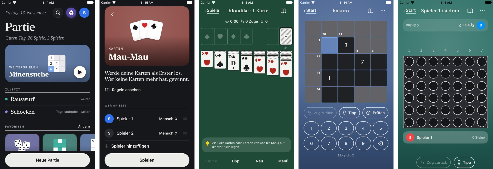
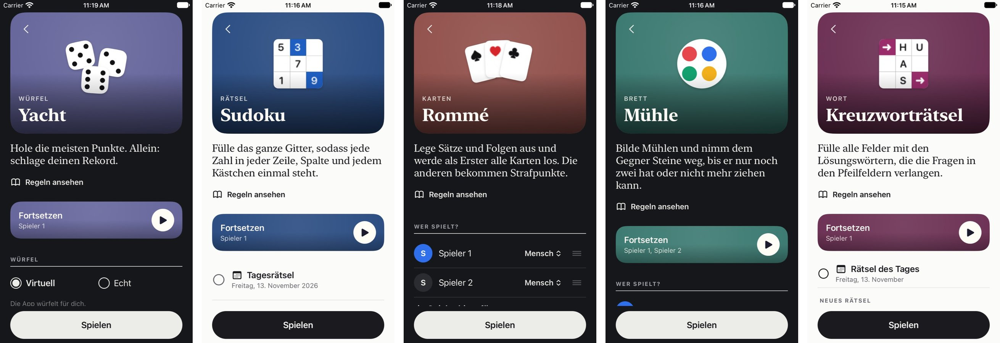

<div align="center">

# Partie

**77 classic games. One app. No fuss.**

Board, cards, dice, puzzles, words and arcade: from the kitchen table to your iPhone and iPad.
No ads. No tracking. No account. Plays fully offline.


[Deutsch](README.md) · [Join the beta](#join-the-beta) · [Contributing](CONTRIBUTING.en.md)

</div>

<p align="center"></p>

## Why Partie?

There are hundreds of game apps. Each has its own ads, its own account, its own look and its own way of being operated. Partie turns that around: **one** calm app that holds the games you know from the kitchen table, game night or a train ride.

- **Offline and private.** No network and no account needed to play. No tracking and no server of ours; the app's privacy manifest declares no collected data. Two things are **optional**: syncing between your devices through *your own* private iCloud, and Game Center for leaderboards (off in kids mode).
- **Everything works alike.** Once you know one game you find your way in all of them: same layout, same buttons, same help. You learn a rule, not a new interface.
- **For the whole family.** From kids mode to chess, backgammon and rummy.
- **Traditional and free.** All games are old public-domain classics. Names are deliberately neutral, with no trademarks in them.

<p align="center"><br><sub>Explained briefly, then you play: every game has its own page with rules, players and statistics.</sub></p>

## The games

| Kind | Includes, among others |
|---|---|
| **Cards** | Solitaire (Klondike, Spider, FreeCell, Pyramid, TriPeaks, Golf, Yukon), Rummy, Mau-Mau, Schwimmen, Cheat, Blackjack-style 21, Crazy-Eights-style games, Truco, Brisca, Escoba and more |
| **Dice** | Yacht, Schocken, 10,000, Mäxchen, Chicago, Shut the Box-style Klappbrett, Liar's Dice, Pig, Bunco and more |
| **Board** | Chess, Backgammon, Checkers, Nine Men's Morris, Halma, Kalaha, Reversi-style Wendespiel, Four in a Row, Ludo-style Rauswurf, Battleship-style games and more |
| **Puzzle** | Sudoku, Kakuro, Nonogram, Bridges, Minesweeper-style Minensuche, Lights Out, Tower of Hanoi, Sliding puzzle, 2048-style Zahlenfusion, Mahjong pairs and more |
| **Words** | Wortpfeil (arrow crossword), Hangman, Stadt Land Fluss |
| **Arcade** | Steinfall, Wolkenhüpfer, Dauerlauf, Mauerbrecher, Ballwechsel |

Every game has a short rule summary and hints, and, depending on the game, tips, undo and lessons.

## How Partie works

### Finding a game
The **start screen** lists all games by kind. Filter by number of players, duration and origin, search by name or keyword (also by the well-known old name), and keep **favorites**. You can also build **your own lists**, such as "Family night" or "On the go".

### "What shall we play?"
Say how many of you there are and how much time you have. Partie suggests matching games, or picks one at random.

### Playing
Almost every game can be played **against the computer** or **taking turns on the same device**. An unfinished game waits on the start screen under "Continue".

### Real dice
In dice games you can play with real dice: say the pips out loud ("three, five, five, one, six", also in English, Spanish and French) or let the camera read them. The iPhone can act as a **dice scanner** and sends only the pip counts to the iPad over local wireless, never images. Speech recognition and camera run on the device. (This part is new and in beta; feedback is very welcome.)

### Players and statistics
Every person gets a profile. Statistics show games per week, wins by kind, history and win rate per game, for everyone together or for each person. Statistics and names stay on the device unless you switch on iCloud sync.

### Something new every day
The **daily task** suggests a different game every day, the same on all devices. One game is enough. There are daily puzzles too, for example in Wortpfeil.

### For all ages
- **Kids mode:** shows only suitable games (no bluffing, no stakes). Switching it off or changing the selection needs Face ID, Touch ID or the device passcode.
- **Quiet mode:** turns off, among other things, the daily task.

### Easy to find
All games appear in **Spotlight search**, **Siri and Shortcuts**, and **widgets** put the game of the day on your home screen.

### Languages
German, English, Spanish and French.

## Join the beta

Partie is not in the App Store yet; version 1.0 is the plan. **Want to play early and tell us what's wrong?** Then you're exactly who we need:

1. Install Apple's **TestFlight** app from the App Store.
2. Open this invitation link: <https://testflight.apple.com/join/Qe3UrUbh>
3. Play what you like and report bugs and wishes as an [issue](../../issues) (English or German). Most helpful: device, iOS version, game, and what you did last.

What interests us most: does a game feel wrong? Is a rule incorrect? Is something hard to find or to read?

## Under the hood

Partie is a Swift project with no third-party libraries (Swift, SwiftUI, Swift Charts, WidgetKit, App Intents). Every game is its **own Swift package**, tested on its own; the app only puts them together.

| Folder | Content |
|---|---|
| `App/` | The app shell: start screen, search, settings, players, statistics, modes |
| `Pakete/SpieleKern`, `ArcadeKern` | Shared game logic, game frame, player management |
| `Pakete/Baukasten` | The design system (product `KlarGlas`): colors, sheets, buttons, thumbnails |
| `Pakete/Wuerfel*` | Dice recognition: spoken pips, camera, wireless link between iPhone and iPad |
| `Pakete/Spiel*` | One package per game, with its own tests (many rule-based via JSON cases) |
| `Pakete/Kern*` | Game logic shared by several games |
| `Widget/` | Home screen widgets |
| `Test/` | Tests for the app shell |
| `docs/` | Images and guidelines |

Adding a game: create a package, provide a `SpielModul`, add one line to the metadata. Details are in [CONTRIBUTING.en.md](CONTRIBUTING.en.md).

**A note on language:** code, comments and commit messages are in German. Issues and pull requests are welcome in English or German.

## Building

Requirements: Xcode 26 or newer, iOS 17 deployment target, [XcodeGen](https://github.com/yonaskolb/XcodeGen).

```bash
cp Lokal.xcconfig.beispiel Lokal.xcconfig   # add your own Team ID
xcodegen
open Partie.xcodeproj
```

Each game can be tested on its own on a Mac, without a simulator:

```bash
cd Pakete/SpielYacht && swift test
```

## Contributing

New games, bug fixes, translations and better puzzles are welcome. Rules and workflow are in [CONTRIBUTING.en.md](CONTRIBUTING.en.md). Every commit needs a `Signed-off-by` line ([DCO](https://developercertificate.org)). Contributors of a game are credited in the app. Please report security issues as described in [SECURITY.md](SECURITY.md).

## License

- **Code:** [MIT](LICENSE)
- **Content** (puzzles, word lists, sounds, game icons, texts): [CC BY 4.0](LICENSE-INHALTE.md)
- The name "Partie", the logo and the app icon are not covered by these licenses.

Where the content comes from is documented in [HERKUNFT.md](HERKUNFT.md). Partie was developed with the help of AI tools.

© 2026 Philipp Stach and contributors
