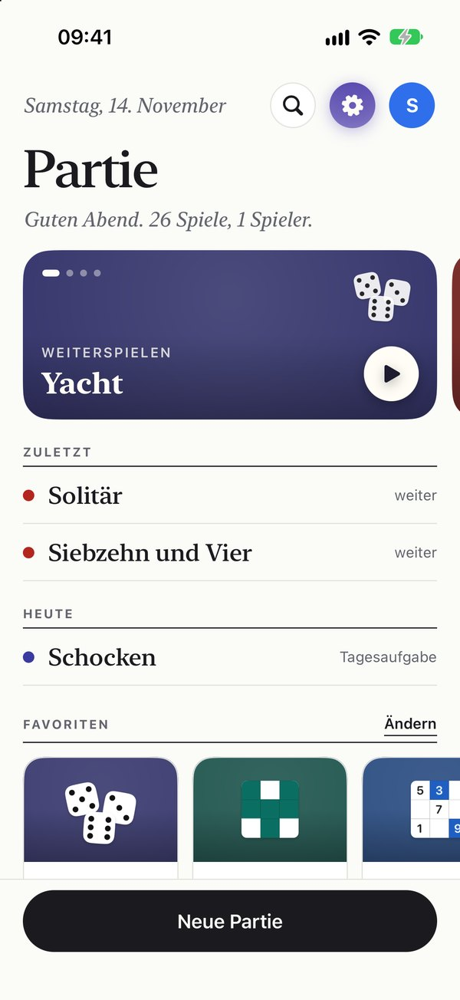
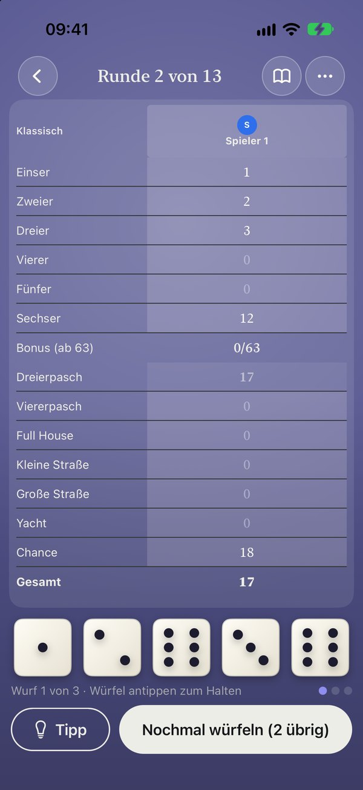
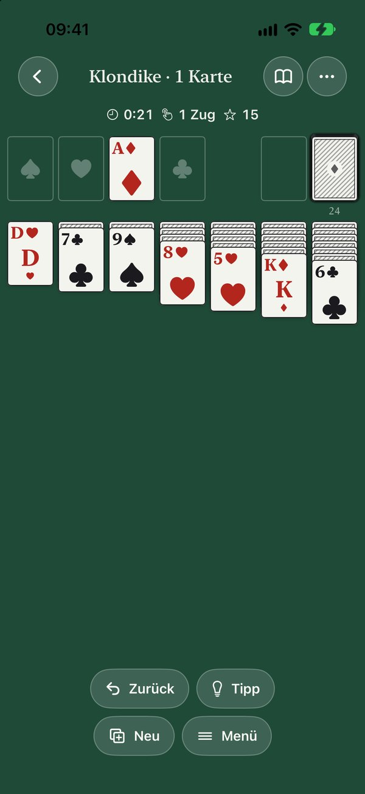
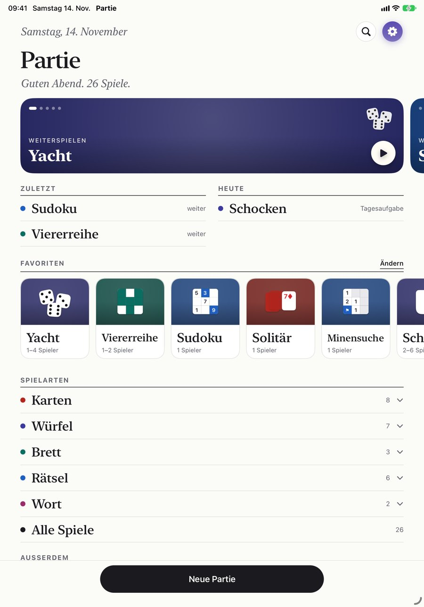
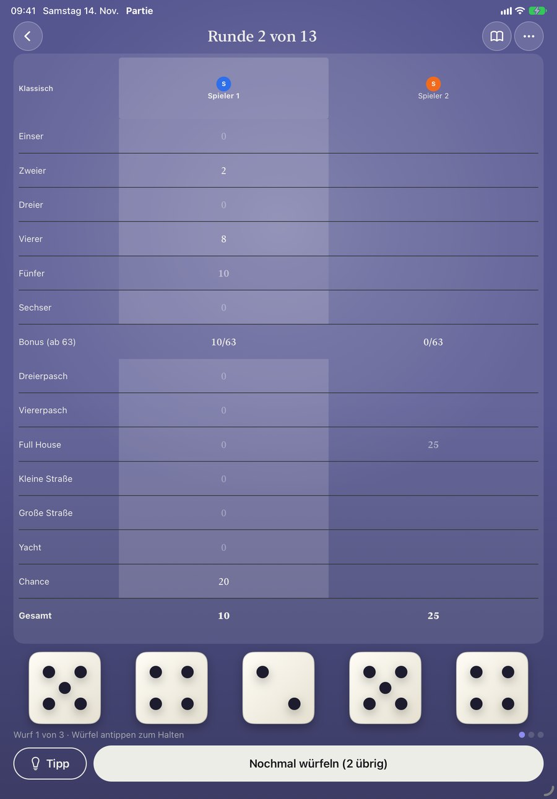

<div align="center">

# Partie

**26 klassische Spiele. Eine App. Kein Schnickschnack. Weitere sind geplant.**

Karten, Würfel, Brett, Rätsel und Wörter: vom Küchentisch auf dein iPhone und iPad.
Ohne Werbung. Ohne Tracking. Ohne Konto. Spielt komplett offline.


[English](README.en.md) · [Beta testen](#beta-testen) · [Mitmachen](CONTRIBUTING.md)

</div>

<p align="center">
  
  
  
</p>
<p align="center">
  
  
  <br><sub>Startseite, Yacht und Solitär auf dem iPhone, Startseite und Yacht auf dem iPad (Design „Tinte“).</sub>
</p>

## Warum Partie?

Auf dem Handy gibt es Hunderte Spiele-Apps. Jede hat ihre eigene Werbung, ihr eigenes Konto, ihren eigenen Look und ihre eigenen Regeln für die Bedienung. Partie dreht das um: **eine** ruhige App, in der die Spiele liegen, die man vom Küchentisch, vom Spieleabend oder aus dem Zugabteil kennt.

- **Offline und privat.** Zum Spielen brauchst du kein Netz und kein Konto. Es gibt kein Tracking und keinen eigenen Server, das Datenschutz-Manifest der App meldet keine gesammelten Daten. Zwei Dinge sind **optional und standardmäßig aus oder ohne Pflicht**: der Abgleich zwischen deinen Geräten über *deine* private iCloud, und Game Center für Bestenlisten (aus im Kinder-Modus).
- **Alles gleich bedienbar.** Wer ein Spiel kann, findet sich in allen zurecht: gleicher Aufbau, gleiche Knöpfe, gleiche Hilfen. Man lernt eine Regel, keine neue Oberfläche.
- **Für die ganze Familie.** Vom Kinder-Modus bis zu Rommé und Mühle.
- **Traditionell und frei.** Alle Spiele sind alte, gemeinfreie Klassiker. Die Namen sind bewusst neutral, es steckt keine Marke darin.


## Die Spiele

**Version 1.0 startet mit 26 Spielen.** Weitere sind geplant, sobald die ersten rund laufen.

| Art | Dabei sind |
|---|---|
| **Karten** | Solitär, Mau-Mau, Schwimmen, Elfer raus, Rommé, Mogeln, Siebzehn und Vier, Herzensjagd |
| **Würfel** | Yacht, Schocken, Zehntausend, Mäxchen, Chicago, Pokerwurf, Königsweg |
| **Rätsel** | Sudoku, Minensuche, Kakuro, Schiebepuzzle, Labyrinth, Farbfüller |
| **Brett** | Viererreihe, Rauswurf, Mühle |
| **Wörter** | Galgenmännchen, Wortpfeil (Kreuzworträtsel) |

Zu jedem Spiel gibt es eine kurze Regel, Hinweise und je nach Spiel Tipps, Rückgängig und Lektionen.

### Ideen für später

Das haben wir schon angefangen oder im Kopf, es ist aber **nicht Teil der 26** und noch nicht angekündigt: Schach, Backgammon, Dame, Halma, Kalaha, Oware, Nonogramm, Brücken, Lichter aus, Turm von Hanoi, Zahlenfusion, Mahjong-Paare, Stadt Land Fluss, Schiffe versenken, Schweinerei, Bunco, Klappbrett, Brisca, Escoba, Truco, Chinchón, Crazy Eights, Steinfall, Wolkenhüpfer, Dauerlauf, Mauerbrecher, Ballwechsel und weitere. Die Reihenfolge ist offen, und Wünsche sind willkommen ([Issue](../../issues)).

## So funktioniert Partie

### Spiel finden
Die **Startseite** zeigt alle Spiele, geordnet nach Art. Du kannst nach Spielerzahl, Dauer und Herkunft filtern, nach Namen oder Stichwort suchen (auch mit dem alten Namen, den man kennt, etwa „Mensch ärgere dich nicht“) und Spiele als **Favoriten** merken. Dazu lassen sich **eigene Listen** anlegen, zum Beispiel „Familienabend“ oder „Unterwegs“.

### „Was spielen wir?“
Gib an, wie viele ihr seid und wie viel Zeit ihr habt. Partie schlägt passende Spiele vor, wenn du magst auch einfach eines per Zufall.

### Spielen
Fast jedes Spiel geht **gegen den Computer** oder **reihum am selben Gerät**. Eine angefangene Partie wartet auf der Startseite unter „Weiterspielen“.

### Echte Würfel
Bei Würfelspielen kannst du mit echten Würfeln spielen: Sag die Augen an („drei, fünf, fünf, eins, sechs“, auch auf Englisch, Spanisch und Französisch) oder lass sie von der Kamera erkennen. Das iPhone kann als **Würfelscanner** dienen und schickt nur die Augenzahlen direkt per lokalem Funk ans iPad, keine Bilder. Spracherkennung und Kamera laufen auf dem Gerät. (Dieser Teil ist neu und in der Beta; wir freuen uns über Rückmeldungen.)

### Spieler und Statistik
Jede Person hat ein eigenes Profil. Die Statistik zeigt Partien je Woche, Siege nach Spielart, den Verlauf und die Siegquote je Spiel, für alle zusammen oder für jede Person einzeln. Statistik und Namen bleiben auf dem Gerät, außer du schaltest den iCloud-Abgleich ein.

### Jeden Tag etwas Neues
Die **Tagesaufgabe** schlägt jeden Tag ein anderes Spiel vor, für alle Geräte gleich. Eine Partie genügt. Dazu gibt es Tagesrätsel, etwa im Wortpfeil.

### Für alle Altersstufen
- **Kinder-Modus:** zeigt nur geeignete Spiele (kein Bluffen, kein Einsatz). Ausschalten und Ändern der Auswahl geht nur mit Face ID, Touch ID oder Gerätecode.
- **Ruhe-Modus:** schaltet unter anderem die Tagesaufgabe ab.

### Überall zu finden
Alle Spiele erscheinen in der **Spotlight-Suche**, in **Siri und Kurzbefehlen**, und mit den **Widgets** liegt das Spiel des Tages direkt auf dem Home-Bildschirm.

### Sprachen
Deutsch, Englisch, Spanisch und Französisch.

## Beta testen

Partie ist noch nicht im App Store. Die Veröffentlichung ist für die Version 1.0 geplant. **Du willst vorab mitspielen und uns sagen, was nicht stimmt?** Dann bist du genau richtig:

1. Installiere die Apple-App **TestFlight** aus dem App Store.
2. Öffne diesen Einladungslink: <https://testflight.apple.com/join/Qe3UrUbh>
3. Spiele, was dir gefällt, und melde Fehler und Wünsche als [Issue](../../issues) (Deutsch oder Englisch). Besonders hilfreich: Gerät, iOS-Version, Spiel und was du zuletzt getan hast.

Am meisten interessiert uns: Fühlt sich ein Spiel falsch an? Stimmt eine Regel nicht? Ist etwas schwer zu finden oder zu lesen?

## Unter der Haube

Partie ist ein Swift-Projekt ohne fremde Bibliotheken (Swift, SwiftUI, Swift Charts, WidgetKit, App Intents). Jedes Spiel ist ein **eigenes Swift-Paket**, das für sich getestet wird, die App fügt sie nur zusammen.

| Ordner | Inhalt |
|---|---|
| `App/` | Die Hülle: Startseite, Suche, Einstellungen, Spieler, Statistik, Modi |
| `Pakete/SpieleKern`, `ArcadeKern` | Gemeinsame Spiellogik, Spielrahmen, Spielerverwaltung |
| `Pakete/Baukasten` | Der gemeinsame **Baukasten** (Produkt `KlarGlas`): Farben, Blätter, Knöpfe, Miniaturen, das Design „Tinte“ |
| `Pakete/Wuerfel*` | Würfelerkennung: Ansage, Kamera, Funk zwischen iPhone und iPad |
| `Pakete/Spiel*` | Ein Paket je Spiel, mit eigenen Tests |
| `Widget/` | Widgets für den Home-Bildschirm |
| `Test/` | Tests für die Hülle |

**Zur Sprache:** Code, Kommentare und Commit-Nachrichten sind auf Deutsch. Issues und Pull Requests sind auf Deutsch oder Englisch willkommen.

## Bauen

Voraussetzungen: Xcode 26 oder neuer, iOS 17, [XcodeGen](https://github.com/yonaskolb/XcodeGen).

```bash
cp Lokal.xcconfig.beispiel Lokal.xcconfig   # eigene Team-ID eintragen
xcodegen
open Partie.xcodeproj
```

Jedes Spiel lässt sich allein auf dem Mac prüfen, ohne Simulator:

```bash
cd Pakete/SpielYacht && swift test
```

## Mitmachen

Ideen, Fehlermeldungen und Übersetzungen sind jederzeit willkommen, am besten als [Issue](../../issues).

**Code-Beiträge freuen uns auch.** Sie gehören an den **gemeinsamen Baukasten** (`Pakete/Baukasten`): Wenn dort etwas besser wird, übernimmt die App es für alle Spiele zugleich. Neue Spiele und Änderungen an einzelnen Spielen nehmen wir vor 1.0 nicht an; die Spiele bleiben vorerst bei uns. Regeln und Ablauf stehen in [CONTRIBUTING.md](CONTRIBUTING.md). Jeder Commit braucht eine `Signed-off-by`-Zeile ([DCO](https://developercertificate.org)). Sicherheitsprobleme bitte nach [SECURITY.md](SECURITY.md) melden.

## Lizenz

- **Code:** [MIT](LICENSE)
- **Inhalte** (Rätsel, Wortlisten, Töne, Spielsymbole, Texte): [CC BY 4.0](LICENSE-INHALTE.md)
- Der Name „Partie“, das Logo und das App-Symbol fallen nicht unter diese Lizenzen.

Woher die Inhalte stammen, steht in [HERKUNFT.md](HERKUNFT.md). Partie wurde mit Hilfe von KI-Werkzeugen entwickelt.

© 2026 Philipp Stach und Mitwirkende
